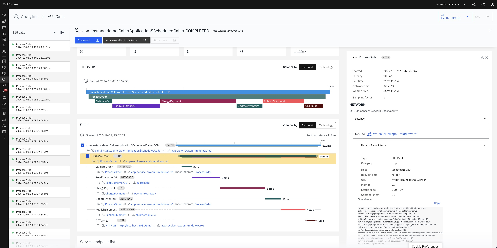

# IDOT OpenTelemetry C++ — Distributed Tracing Sample

This sample shows how a C++ service instrumented with the **IDOT OpenTelemetry C++ SDK** participates in an end-to-end distributed trace together with Java services. When you send a single HTTP request, all three services produce spans that appear under one shared trace ID in your observability backend.

---

## What is distributed tracing and why does it matter?

In a microservices or multi-language architecture, a single user request typically crosses several services — a gateway, a business logic service, a database proxy, a notification service. When something goes wrong or is slow, a traditional log search tells you only what each individual service saw in isolation. You cannot easily answer:

- Which service in the call chain is responsible for the latency?
- Did the C++ service call the downstream Java service successfully, and how long did it take?
- Did a database query inside the C++ service time out, or did the problem originate upstream?

**Distributed tracing** solves this by stitching together the work done across all services into a single, end-to-end **trace**. Each unit of work is recorded as a **span**. Spans carry a shared **trace ID** so your observability backend can reconstruct the full call graph — showing you every service, every operation, and how long each one took, all in one view.

### How trace context is carried between services — W3C `traceparent`

The mechanism that links spans across service boundaries is context propagation. This sample uses the **W3C Trace Context** standard, which defines a single HTTP header:

```
traceparent: 00-<traceId>-<parentSpanId>-<flags>
```

| Field | What it contains |
|---|---|
| `traceId` | A 16-byte (32 hex character) ID unique to the entire request chain. Every span in the trace shares this ID. |
| `parentSpanId` | The span ID of the caller's span. This is how the backend knows which span is the parent of which. |
| `flags` | Sampling flags (`01` = sampled). |

When `java-caller` calls `cpp-service`, the OTel Java Agent automatically injects this header into the outgoing HTTP request. `cpp-service` reads the header, extracts the trace context, and creates its spans as children of the caller's span — preserving the same `traceId`. When `cpp-service` then calls `java-receiver`, it injects a new `traceparent` carrying the same `traceId` and its own `spanId` as the parent. The result is a single connected trace visible in your backend.

---

## Prerequisites

The C++ source code (`main.cpp`) and its build system (`CMakeLists.txt`) support **Windows**, **Linux**, and **AIX**.

| Platform | Build script | Run script | Stop script |
|---|---|---|---|
| Linux / AIX | `build.sh` (Bash) | `run.sh` (Bash) | `stop.sh` (Bash) |
| Windows | `build.ps1` (PowerShell) | `run.ps1` (PowerShell) | `stop.ps1` (PowerShell) |

### Software requirements

| Requirement | Minimum version | How to verify |
|---|---|---|
| C++ compiler | C++17 capable | Linux: GCC (`g++ --version`) · AIX: XL C++ or GCC from AIX Toolbox · Windows: MSVC (`cl.exe`) |
| CMake | 3.16 | `cmake --version` — available from AIX Toolbox on AIX |
| Bash | 4.0 or later | AIX ships `/bin/sh` (ksh); install Bash from AIX Toolbox: `rpm -i bash-*.rpm` · verify: `bash --version` |
| libcurl | — | Linux: `dnf install libcurl-devel` or `apt install libcurl4-openssl-dev` · AIX: `rpm -i curl-devel-*.rpm` from AIX Toolbox · Windows: download from [curl.se](https://curl.se/windows/) |
| IDOT OpenTelemetry C++ SDK | — | An installed or extracted SDK directory. Set its location via `IDOT_OTEL_CPP_INSTALL`. See platform notes below for the expected directory layout. |
| Java | 8 or later | `java -version` |
| Maven | 3.6 or later | `mvn --version` |
| OpenTelemetry Java Agent JAR | — | Download from [opentelemetry-java-instrumentation releases](https://github.com/open-telemetry/opentelemetry-java-instrumentation/releases). Set the path via `OTEL_AGENT`. |
| OpenTelemetry Collector or OTLP/gRPC backend | — | Any OTLP/gRPC-compatible endpoint. See [Connecting to a collector](#connecting-to-an-opentelemetry-collector). |

### SDK directory layout by platform

The IDOT OpenTelemetry C++ SDK install directory structure differs by platform. CMake locates headers and libraries through `IDOT_OTEL_CPP_INSTALL`; the shared libraries must also be on the runtime library search path.

| Platform | CMake config file location | Shared library location | Runtime path variable |
|---|---|---|---|
| Linux | `$IDOT_OTEL_CPP_INSTALL/lib64/cmake/opentelemetry-cpp/` | `$IDOT_OTEL_CPP_INSTALL/lib64/` | `LD_LIBRARY_PATH` |
| AIX | `$IDOT_OTEL_CPP_INSTALL/lib/cmake/opentelemetry-cpp/` | `$IDOT_OTEL_CPP_INSTALL/lib/` | `LIBPATH` |
| Windows | `%IDOT_OTEL_CPP_INSTALL%\lib\cmake\opentelemetry-cpp\` | `%IDOT_OTEL_CPP_INSTALL%\bin\` | `PATH` |

> If your SDK layout differs from the table above, pass the correct path directly to CMake: `cmake -B build -DCMAKE_PREFIX_PATH=<path>`.

---

## Quick start

```bash
# 1. Clone and enter the directory
git clone <repository-url>
cd idot-cpp-distributed-tracing

# 2. Build all three services
IDOT_OTEL_CPP_INSTALL=<path-to-opentelemetry-cpp> ./build.sh

# 3. Start all three services
IDOT_OTEL_CPP_INSTALL=<path-to-opentelemetry-cpp> \
OTEL_AGENT=<path-to-opentelemetry-javaagent.jar> \
CPP_OTLP_ENDPOINT=<collector-host>:<grpc-port> \
JAVA_OTLP_ENDPOINT=http://<collector-host>:<grpc-port> \
./run.sh

# 4. Trigger a trace
curl http://<host>:8082/order

# 5. Stop all services
./stop.sh
```

See [Environment variables](#environment-variables) for a full description of each variable before you run.

---

## How it works

```
  curl http://<host>:8082/order
           │
           │ HTTP GET /order
           ▼
  ┌─────────────────────┐
  │   java-caller       │  Spring Boot — OTel Java Agent (auto-instrumented)
  └──────────┬──────────┘
             │ HTTP GET /order  +  W3C traceparent header
             ▼
  ┌─────────────────────┐
  │   cpp-service       │  IDOT OpenTelemetry C++ SDK — manual instrumentation
  └──────────┬──────────┘
             │ HTTP GET /ping  +  W3C traceparent header
             ▼
  ┌─────────────────────┐
  │   java-receiver     │  Spring Boot — OTel Java Agent (auto-instrumented)
  └──────────┬──────────┘
             │ OTLP/gRPC  (all three services export independently)
             ▼
  OpenTelemetry Collector / Backend
```

Each service exports its own spans to the configured OTLP/gRPC endpoint. The W3C `traceparent` header carries the trace context from service to service so all spans share the same trace ID.

---

## Span tree

Each `GET /order` request produces the following trace waterfall:

```
java-caller   GET /order                                  SERVER  (auto-instrumented)
│
└─ java-caller  HTTP GET                                  CLIENT  (auto-instrumented)
   │
   └─ cpp-service  ProcessOrder                           SERVER
      ├─ cpp-service  ValidateOrder                       INTERNAL
      ├─ cpp-service  ReadCustomerDB                      CLIENT   (simulated)
      ├─ cpp-service  ChargePayment                       CLIENT   (simulated)
      ├─ cpp-service  UpdateInventory                     INTERNAL
      ├─ cpp-service  PublishShipment                     PRODUCER (simulated)
      └─ cpp-service  HTTP GET <java-receiver-url>/ping   CLIENT
         │
         └─ java-receiver  GET /ping                      SERVER   (auto-instrumented)
```

`ReadCustomerDB`, `ChargePayment`, and `PublishShipment` are simulated — they demonstrate OpenTelemetry semantic attributes for database, RPC, and messaging operations without requiring a real database, payment gateway, or message broker.

---

## What the sample covers

The instrumentation in [`cpp-service/src/main.cpp`](cpp-service/src/main.cpp) demonstrates:

| Concept | Where in the code |
|---|---|
| SDK initialisation — tracer provider, OTLP/gRPC exporter, resource attributes | `InitTelemetry()` |
| BatchSpanProcessor — async, buffered export | `InitTelemetry()` |
| W3C Trace Context extraction — join the trace started by `java-caller` | `HandleOrder()` |
| Span creation — `SERVER`, `CLIENT`, `INTERNAL`, `PRODUCER` span kinds | `HandleOrder()` |
| Span attributes — HTTP, database, RPC, and messaging semantic conventions | `HandleOrder()` |
| Span events — timestamped annotations attached to a span | `HandleOrder()` — `ChargePayment`, `PublishShipment` |
| W3C Trace Context injection — propagate to `java-receiver` | `CallDownstream()` |
| Span status — `kOk` and `kError` | `CallDownstream()`, `HandleOrder()` |
| Graceful shutdown — `ForceFlush` then `Shutdown` | `ShutdownTelemetry()`, `main()` |

The Java services use the OpenTelemetry Java Agent for automatic instrumentation — no manual instrumentation is required in their code.

---

## Project structure

```
idot-cpp-distributed-tracing/
├── build.sh                     — build all three services         (Linux / AIX)
├── build.ps1                    — build all three services         (Windows)
├── run.sh                       — start all three services         (Linux / AIX)
├── run.ps1                      — start all three services         (Windows)
├── stop.sh                      — stop all running services        (Linux / AIX)
├── stop.ps1                     — stop all running services        (Windows)
│
├── images/
│   └── distributed_tracing.jpg  — Instana trace waterfall screenshot
│
├── cpp-service/                 ← IDOT OTel C++ SDK instrumentation is here
│   ├── CMakeLists.txt
│   ├── vendor/httplib.h         — vendored header-only HTTP server
│   └── src/main.cpp             — full OTel C++ SDK instrumentation example
│
├── java-caller/                 — Spring Boot, exposes GET /order
│   ├── pom.xml
│   └── src/main/java/com/example/demo/CallerApplication.java
│
└── java-receiver/               — Spring Boot, answers GET /ping
    ├── pom.xml
    └── src/main/java/com/example/demo/ReceiverApplication.java
```

---

## Environment variables

Configure these variables for your environment before running `build.sh` or `run.sh`.

### Required

| Variable | Used by | Description |
|---|---|---|
| `IDOT_OTEL_CPP_INSTALL` | `build.sh`, `run.sh` | Absolute path to the root of the IDOT OpenTelemetry C++ SDK install directory. Used by CMake at build time (`CMAKE_PREFIX_PATH`) and added to the platform runtime library path at run time (see [SDK directory layout by platform](#sdk-directory-layout-by-platform)). |
| `OTEL_AGENT` | `run.sh` | Absolute path to the OpenTelemetry Java Agent JAR. Attached to `java-caller` and `java-receiver` via `-javaagent`. |

### Collector / backend endpoints

Both variables default to `localhost:4317` / `http://localhost:4317`. Set them if your collector is on a different host or port.

| Variable | Used by | Format | Default |
|---|---|---|---|
| `CPP_OTLP_ENDPOINT` | `run.sh` → `cpp-service` | Bare `host:port` — **no** URL scheme | `localhost:4317` |
| `JAVA_OTLP_ENDPOINT` | `run.sh` → `java-caller`, `java-receiver` | Full URL `http://host:port` | `http://localhost:4317` |

> `CPP_OTLP_ENDPOINT` and `JAVA_OTLP_ENDPOINT` must be set **independently**. The C++ gRPC exporter requires a bare `host:port`; the Java Agent requires a full `http://` URL. If your collector is remote, set both.

### Scheduler

| Variable | Used by | Description | Default |
|---|---|---|---|
| `SCHEDULE_ENABLED` | `run.sh` → `java-caller` | `true` — `java-caller` automatically sends one `GET /order` every 5 seconds. `false` — send requests manually with `curl`. | `false` — trigger traces manually with `curl http://<host>:8082/order`. Set to `true` for continuous traffic. |

### Service ports and inter-service URLs

`run.sh` hard-codes the ports and service-to-service URLs below. Setting these variables externally before calling `run.sh` has no effect — edit `run.sh` directly if you need different values.

| Variable | Consumed by | Description | Value in `run.sh` |
|---|---|---|---|
| `SERVER_PORT` | `cpp-service` | TCP port `cpp-service` listens on. | `8080` |
| `SERVER_HOST` | `cpp-service` | Hostname written into `cpp-service` span attributes. Does not change the bind address (`0.0.0.0`). | _(not set by `run.sh`)_ |
| `JAVA_RECEIVER_URL` | `cpp-service` | Base URL of `java-receiver`. `cpp-service` appends `/ping` for the downstream call. | `http://localhost:8081` |
| `CPP_SERVICE_URL` | `java-caller` | Base URL of `cpp-service`. `java-caller` calls `$CPP_SERVICE_URL/order`. | `http://localhost:8080` |

### Service names

`run.sh` assigns a distinct `OTEL_SERVICE_NAME` to each service. These values are fixed in the script and appear as separate service nodes in your observability backend.

| Service | `OTEL_SERVICE_NAME` |
|---|---|
| `java-caller` | `java-caller` |
| `cpp-service` | `cpp-service` |
| `java-receiver` | `java-receiver` |

---

## Step 1 — Build

### Linux

```bash
cd idot-cpp-distributed-tracing
IDOT_OTEL_CPP_INSTALL=<path-to-opentelemetry-cpp> ./build.sh
```

### AIX

`OBJECT_MODE=64` selects the 64-bit toolchain and must be exported before building.

```bash
export OBJECT_MODE=64
cd idot-cpp-distributed-tracing
IDOT_OTEL_CPP_INSTALL=<path-to-opentelemetry-cpp> ./build.sh
```

`build.sh` builds the three services in this order:
1. `java-caller` → `java-caller/target/java-caller-1.0.0.jar`
2. `java-receiver` → `java-receiver/target/java-receiver-1.0.0.jar`
3. `cpp-service` → `cpp-service/build/cpp-service`

### Windows

Open **Developer PowerShell for VS 2022** (*Start → Visual Studio 2022 → Developer PowerShell for VS 2022*).

> **Execution policy:** If you see `cannot be loaded because running scripts is disabled`, run:
> `Set-ExecutionPolicy -Scope CurrentUser -ExecutionPolicy RemoteSigned`

`opentelemetry_cpp.dll` is copied next to `cpp-service.exe` automatically after each build. The OpenSSL DLLs must also be on `PATH` before running — add your OpenSSL `bin\` directory to `PATH` first:

```powershell
$env:PATH = "C:\Program Files\OpenSSL-Win64\bin;$env:PATH"
$env:IDOT_OTEL_CPP_INSTALL = "<path-to-opentelemetry-cpp>"
.\build.ps1
```

Parameters can also be passed directly:

```powershell
.\build.ps1 -IdotOtelCppInstall "<path-to-opentelemetry-cpp>"
```

`build.ps1` builds the three services in this order:
1. `java-caller` → `java-caller\target\java-caller-1.0.0.jar`
2. `java-receiver` → `java-receiver\target\java-receiver-1.0.0.jar`
3. `cpp-service` → `cpp-service\build\Release\cpp-service.exe`

It uses `$env:NUMBER_OF_PROCESSORS` for the parallel build (PowerShell equivalent of `nproc`).

---

## Step 2 — Start the services

### Linux and AIX — default (collector on the same host)

```bash
IDOT_OTEL_CPP_INSTALL=<path-to-opentelemetry-cpp> \
OTEL_AGENT=<path-to-opentelemetry-javaagent.jar> \
./run.sh
```

### Linux and AIX — remote collector

```bash
IDOT_OTEL_CPP_INSTALL=<path-to-opentelemetry-cpp> \
OTEL_AGENT=<path-to-opentelemetry-javaagent.jar> \
CPP_OTLP_ENDPOINT=<collector-host>:<grpc-port> \
JAVA_OTLP_ENDPOINT=http://<collector-host>:<grpc-port> \
./run.sh
```

### Linux and AIX — continuous traffic (enable the automatic scheduler)

```bash
IDOT_OTEL_CPP_INSTALL=<path-to-opentelemetry-cpp> \
OTEL_AGENT=<path-to-opentelemetry-javaagent.jar> \
SCHEDULE_ENABLED=true \
./run.sh
```

### Windows

`run.ps1` starts each service as a background process using `System.Diagnostics.Process`, redirects stdout and stderr to the `logs\` directory, and writes a `.pids.json` file so `stop.ps1` can terminate the correct processes. It also adds `$IdotOtelCppInstall\bin` to `PATH` for any additional SDK DLLs.

```powershell
$env:IDOT_OTEL_CPP_INSTALL = "<path-to-opentelemetry-cpp>"
$env:OTEL_AGENT             = "<path-to-opentelemetry-javaagent.jar>"
$env:CPP_OTLP_ENDPOINT      = "<collector-host>:<grpc-port>"
$env:JAVA_OTLP_ENDPOINT     = "http://<collector-host>:<grpc-port>"
.\run.ps1
```

Parameters can also be passed directly:

```powershell
.\run.ps1 `
    -IdotOtelCppInstall "<path-to-opentelemetry-cpp>" `
    -OtelAgent          "<path-to-opentelemetry-javaagent.jar>" `
    -CppOtlpEndpoint    "<collector-host>:<grpc-port>" `
    -JavaOtlpEndpoint   "http://<collector-host>:<grpc-port>" `
    -ScheduleEnabled    $true
```

---

After startup, each service writes logs to the `logs/` directory:

| Service | Default port | Log file |
|---|---|---|
| `java-caller` | `8082` | `logs/java-caller.log` |
| `cpp-service` | `8080` | `logs/cpp-service.log` |
| `java-receiver` | `8081` | `logs/java-receiver.log` |

Confirm all three services are up before sending a request. Look for these lines in the logs:

```
# logs/java-caller.log
Started CallerApplication in ...

# logs/cpp-service.log
Listening on :8080 — waiting for requests from java-caller...

# logs/java-receiver.log
Started ReceiverApplication in ...
```

---

## Step 3 — Trigger a trace

Send a single request to `java-caller`:

```bash
curl http://<host>:8082/order
```

Expected response:

```
order processed — notify: pong
```

The `cpp-service` log prints the extracted and injected `traceparent` values so you can confirm context propagation:

```
[cpp-service] Extracted traceparent from java-caller : 00-<traceId>-<spanId>-01
[cpp-service] Injected  traceparent into java-receiver: 00-<traceId>-<spanId>-01
```

The trace ID shown in both lines is the same — that is the trace ID shared across all three services.

---

## Step 4 — View and verify traces

Open your observability backend. Filter by `service.name = cpp-service` or operation name `ProcessOrder`. The trace waterfall should show all three services linked under a single trace ID.

The screenshot below shows an example trace as it appears in **IBM Instana**. The same end-to-end waterfall is visible in any OTLP-compatible backend.



*IBM Instana — end-to-end distributed trace. The `ProcessOrder` SERVER span in `cpp-service` contains all expected child spans: `ValidateOrder` (INTERNAL, 8ms), `ReadCustomerDB` (DATABASE, 22ms), `ChargePayment` (RPC, 35ms), `UpdateInventory` (INTERNAL, 12ms), `PublishShipment` (MESSAGING, 19ms), and `GET /ping` (HTTP, 9ms) — which continues the trace into `java-receiver`. Total root call latency: 112ms.*

**Confirm the following:**

- `java-caller`, `cpp-service`, and `java-receiver` appear in the same trace under one trace ID.
- The span tree matches the structure shown in [Span tree](#span-tree).
- The `traceparent` header carries the same trace ID Java → C++ → Java (visible in the `cpp-service` log output).
- `cpp-service` spans carry the attribute `service.name = cpp-service`.
- All spans are exported to the configured OTLP/gRPC endpoint.

---

## Step 5 — Stop

### Linux and AIX

```bash
./stop.sh
```

### Windows

```powershell
.\stop.ps1
```

`stop.ps1` reads `.pids.json` written by `run.ps1` and calls `Stop-Process` for each recorded PID. It then scans ports 8080–8082 with `netstat` and force-kills any remaining processes — the PowerShell equivalent of `fuser -k <port>/tcp`.

---

## Connecting to an OpenTelemetry Collector

This sample exports spans over OTLP/gRPC and works with any OpenTelemetry Collector or OTLP-compliant backend.

### Starting with a remote collector

```bash
IDOT_OTEL_CPP_INSTALL=<path-to-opentelemetry-cpp> \
OTEL_AGENT=<path-to-opentelemetry-javaagent.jar> \
CPP_OTLP_ENDPOINT=<collector-host>:<grpc-port> \
JAVA_OTLP_ENDPOINT=http://<collector-host>:<grpc-port> \
./run.sh
```

### Minimal Collector configuration

```yaml
receivers:
  otlp:
    protocols:
      grpc:
        endpoint: "0.0.0.0:<grpc-port>"

exporters:
  otlp/backend:
    endpoint: "<backend-host>:<port>"
    tls:
      insecure: true

service:
  pipelines:
    traces:
      receivers: [otlp]
      exporters: [otlp/backend]
```

Replace `otlp/backend` with the exporter for your backend (Jaeger, Zipkin, a SaaS platform, etc.). See the [OpenTelemetry Collector documentation](https://opentelemetry.io/docs/collector/) for all available exporters and configuration options.

---

## Applying this to your own C++ service

The patterns in [`cpp-service/src/main.cpp`](cpp-service/src/main.cpp) are designed to be copied into your own service. Here is the sequence every instrumented C++ service must follow:

### 1. Initialise the SDK once at startup

Call `InitTelemetry()` (or equivalent) before serving any requests. This sets up:
- The **OTLP/gRPC exporter** — points to your collector via `OTEL_EXPORTER_OTLP_ENDPOINT`
- The **BatchSpanProcessor** — buffers and exports spans asynchronously so instrumentation does not block request handling
- **Resource attributes** — `service.name`, `host.name`, `process.pid` — attached to every span this process emits
- The **global W3C propagator** — registers `HttpTraceContext` so `Extract` and `Inject` work correctly

### 2. Extract incoming trace context at the start of each request handler

If your service receives HTTP requests from an upstream service that is also instrumented with OpenTelemetry, the upstream will have injected a `traceparent` header. Extract it and attach the resulting context so your spans become children of the upstream span:

```cpp
// Create a carrier that reads from your framework's request headers
HttplibRequestCarrier carrier(req.headers);

// Extract the upstream context
auto parent_ctx = propagation::GlobalTextMapPropagator::GetGlobalPropagator()
                      ->Extract(carrier, ctx::RuntimeContext::GetCurrent());

// Attach it — all spans created on this thread will carry the same traceId
auto token = ctx::RuntimeContext::Attach(parent_ctx);
```

If no `traceparent` header is present (e.g. the request originates from outside an instrumented system), `Extract` returns an empty context and the SDK starts a new trace automatically.

### 3. Create a SERVER span for the inbound request

Mark the entry point of your handler with `SpanKind::kServer`:

```cpp
trace::StartSpanOptions opts;
opts.parent = parent_ctx;
opts.kind   = trace::SpanKind::kServer;
auto root = tracer->StartSpan("YourOperationName", opts);
trace::Scope root_scope(root);   // makes root the active span on this thread
```

Add HTTP semantic attributes so your backend correlates this SERVER span with the CLIENT span from the caller:

```cpp
root->SetAttribute("http.method",  req.method);   // "GET", "POST", ...
root->SetAttribute("http.route",   "/your-path");
root->SetAttribute("server.address", srv_host);
root->SetAttribute("server.port",    srv_port);
```

### 4. Create child spans for each unit of work

Each distinct operation in your handler — a database query, an RPC call, internal business logic — should be its own span. Use the correct `SpanKind` for each:

| `SpanKind` | Use for |
|---|---|
| `kInternal` | Work done entirely inside this service (validation, computation, in-process logic) |
| `kClient` | Outbound synchronous calls — database queries, HTTP calls to other services, RPC |
| `kProducer` | Fire-and-forget message publishes to a queue or topic |

```cpp
// INTERNAL span — in-process work
{
    auto span = tracer->StartSpan("ValidateInput", ChildOf(trace::SpanKind::kInternal));
    trace::Scope s(span);
    // ... your logic ...
    span->SetStatus(trace::StatusCode::kOk);
    span->End();
}

// CLIENT span — outbound database call
{
    auto span = tracer->StartSpan("QueryDatabase", ChildOf(trace::SpanKind::kClient));
    trace::Scope s(span);
    span->SetAttribute("db.system",    "postgresql");
    span->SetAttribute("db.name",      "orders");
    span->SetAttribute("db.operation", "SELECT");
    // ... your query ...
    span->SetStatus(trace::StatusCode::kOk);
    span->End();
}
```

Use `ChildOf()` (the helper in [`main.cpp`](cpp-service/src/main.cpp)) to parent each child span under the current active context automatically.

### 5. Inject trace context into outbound HTTP calls

When your service calls a downstream service that is also instrumented, inject the `traceparent` header so the downstream spans become children of your CLIENT span:

```cpp
// Create a carrier that collects headers to add to the outbound request
CurlHeaderCarrier carrier;
propagation::GlobalTextMapPropagator::GetGlobalPropagator()
    ->Inject(carrier, ctx::RuntimeContext::GetCurrent());

// Add the collected headers to your HTTP request (example using libcurl)
struct curl_slist* hlist = nullptr;
for (auto& [k, v] : carrier.headers)
    hlist = curl_slist_append(hlist, (k + ": " + v).c_str());
curl_easy_setopt(curl, CURLOPT_HTTPHEADER, hlist);
```

The downstream service calls `Extract` on the same header to continue the trace — no manual trace ID passing is required.

### 6. Set span status and end every span

Always call `SetStatus` and `End` on every span you create. An unended span is never exported.

```cpp
if (/* operation succeeded */) {
    span->SetStatus(trace::StatusCode::kOk);
} else {
    span->SetStatus(trace::StatusCode::kError, "descriptive error message");
}
span->End();
```

### 7. Detach the context and shut down cleanly

After the request is complete, detach the extracted context:

```cpp
ctx::RuntimeContext::Detach(*token);
```

At process shutdown, flush and release the SDK before exiting. Without this, spans still buffered in the `BatchSpanProcessor` queue are lost:

```cpp
g_provider->ForceFlush(std::chrono::milliseconds(10'000));
g_provider->Shutdown();
```

### Span attributes — semantic conventions

OpenTelemetry defines standard attribute names for common operations. Using them ensures your backend can automatically interpret and display spans correctly. Key conventions used in this sample:

| Operation type | Key attributes |
|---|---|
| HTTP server (inbound) | `http.method`, `http.route`, `http.status_code`, `server.address`, `server.port` |
| HTTP client (outbound) | `http.method`, `http.url`, `http.status_code`, `server.address`, `server.port` |
| Database | `db.system`, `db.name`, `db.operation`, `db.statement` |
| RPC | `rpc.system`, `rpc.service`, `rpc.method` |
| Messaging | `messaging.system`, `messaging.destination`, `messaging.operation` |

See the full [OpenTelemetry Semantic Conventions](https://opentelemetry.io/docs/specs/semconv/) reference for all supported attribute names.

---

## Troubleshooting

### No spans appear in the backend

1. **Verify the OTLP endpoint variables are set correctly.**
   - `CPP_OTLP_ENDPOINT` must be a bare `host:port` with no scheme (e.g. `collector:4317`). This applies on all platforms — Linux, AIX, and Windows (`run.ps1` maps it to `OTEL_EXPORTER_OTLP_ENDPOINT` internally).
   - `JAVA_OTLP_ENDPOINT` must be a full URL (e.g. `http://collector:4317`).
2. **Check the collector is reachable** from the host running the services.

   | Platform | Command |
   |---|---|
   | Linux | `nc -zv <collector-host> <grpc-port>` |
   | AIX | `netstat -an \| grep <grpc-port>` |
   | Windows | `Test-NetConnection <collector-host> -Port <grpc-port>` (PowerShell) |

3. **Check the log files** under `logs/` for connection errors or stack traces.

### `cpp-service` fails to start — shared library not found

The SDK shared libraries must be on the runtime library search path. Verify by platform:

| Platform | Command | Path variable |
|---|---|---|
| Linux | `ls $IDOT_OTEL_CPP_INSTALL/lib64/libopentelemetry*.so` | `LD_LIBRARY_PATH` |
| AIX | `ls $IDOT_OTEL_CPP_INSTALL/lib/libopentelemetry*.so` | `LIBPATH` |
| Windows | `dir %IDOT_OTEL_CPP_INSTALL%\bin\opentelemetry*.dll` | `PATH` |

`run.sh` automatically detects AIX via `uname` and sets `LIBPATH` pointing to `$IDOT_OTEL_CPP_INSTALL/lib`. On Linux it sets `LD_LIBRARY_PATH` pointing to `lib64/`. On Windows, add the SDK `bin\` directory to `PATH`.

### Build fails — `opentelemetry-cpp` package not found

CMake searches for `opentelemetry-cpp-config.cmake` inside `IDOT_OTEL_CPP_INSTALL`. Verify the file exists at the platform-specific path:

| Platform | Expected path |
|---|---|
| Linux | `$IDOT_OTEL_CPP_INSTALL/lib64/cmake/opentelemetry-cpp/opentelemetry-cpp-config.cmake` |
| AIX | `$IDOT_OTEL_CPP_INSTALL/lib/cmake/opentelemetry-cpp/opentelemetry-cpp-config.cmake` |
| Windows | `%IDOT_OTEL_CPP_INSTALL%\lib\cmake\opentelemetry-cpp\opentelemetry-cpp-config.cmake` |

### Port already in use

The default ports are `8080` (`cpp-service`), `8081` (`java-receiver`), and `8082` (`java-caller`). Identify conflicting processes:

| Platform | Command |
|---|---|
| Linux | `ss -tlnp \| grep -E '8080\|8081\|8082'` |
| AIX | `netstat -an \| grep -E '8080\|8081\|8082'` |
| Windows | `netstat -ano \| findstr "8080 8081 8082"` |

To use different ports, edit the port assignments in `run.sh` (Linux/AIX) or `run.ps1` (Windows — update the `SERVER_PORT`, `JAVA_RECEIVER_URL`, and `CPP_SERVICE_URL` values in the `-ExtraEnv` and `-Arguments` sections), and update `JAVA_RECEIVER_URL` and `CPP_SERVICE_URL` to match.

### `curl` returns an error or no response

Confirm `java-caller` is ready before sending requests — the JVM takes a few seconds to start. Check `logs/java-caller.log` for `Started CallerApplication`, then retry.

### Trace shows only one or two services

This usually means one service is not exporting to the same backend. Verify:
- All three `OTEL_SERVICE_NAME` values (`java-caller`, `cpp-service`, `java-receiver`) appear in your backend's service list.
- `CPP_OTLP_ENDPOINT` and `JAVA_OTLP_ENDPOINT` both point to the same collector.
- The `traceparent` header appears in the `cpp-service` log output (printed on every request).
