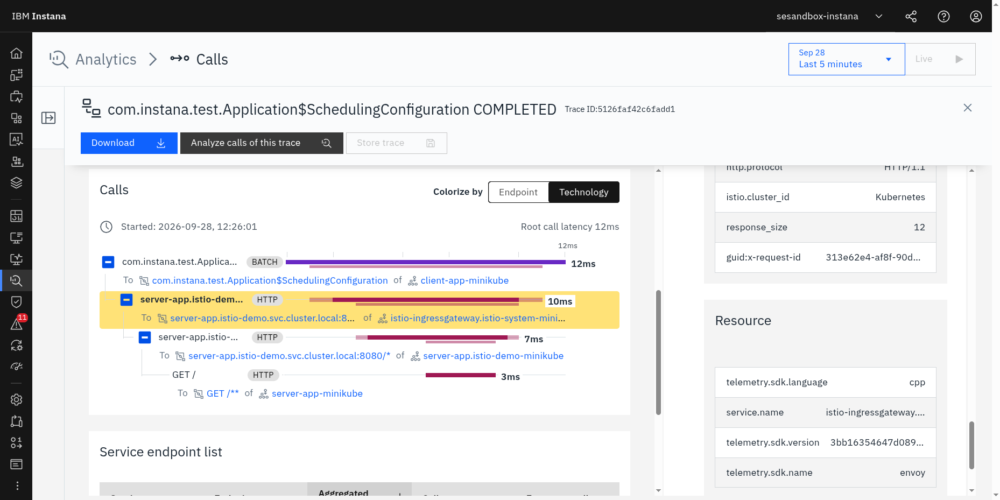

# Istio Gateway: Instana OTel Tracing Demo

This repository demonstrates Instana's [Istio Gateway](https://istio.io/) tracing functionality
based on [OpenTelemetry](https://opentelemetry.io/docs/languages/cpp/).

The OTel traces are sent to the Instana agent OpenTelemetry plugin via OTLP HTTP to port 4318.
It has to
[be enabled](https://www.ibm.com/docs/en/instana-observability/current?topic=opentelemetry-sending-data-instana-agent)
for this. This is the only supported scenario for now.

## Supported Versions

Istio 1.31.1 is used here.

## Prerequisites

A `docker-compose` installation running on your machine and a [minikube setup](./minikube/README.md).

The `curl` command is required to download Istio.

Download Istio and copy the `istioctl` executable to a location accessible by PATH environment variable:
```
curl -L https://istio.io/downloadIstio | ISTIO_VERSION=1.31.1 TARGET_ARCH=x86_64 sh -
sudo cp istio-1.31.1/bin/istioctl /usr/local/bin/
istioctl --help
```

## Configure

Create a `.env` file in the root of the checked-out version of this repository and enter the following content.
The values need to be adjusted to your environment.

```text
agent_key=<agent secret key>
download_key=<download secret key (optional agent key with download privileges)>
agent_zone=<name of the zone for the agent; default: istio-tracing-demo>
agent_endpoint=<local ip or remote host; e.g. ingress-red-saas.instana.io>
agent_endpoint_port=<443 already set as default; or 4443 for local>
```

In most scenarios only the field `agent_key` and `agent_endpoint` are required.

A template [.env.template](.env.template) can be copied to `.env` for your convenience.

## Build & Launch

Istio requires Kubernetes.

See: [minikube/README.md](./minikube/README.md)

-------------------------

Simple test if docker-compose is working without Istio:

```bash
./run_demo.sh
```

This will build and launch the following components:
- `client-app` service, a simple Spring Boot application that issues a request every second to the ...
- `server-app` service, a simple Spring Boot application that returns `200` to any HTTP request.

## Run this in minikube

See: [minikube/README.md](./minikube/README.md)

## View this in Instana

This is how this is looking in the Analyze View on Instana UI:


