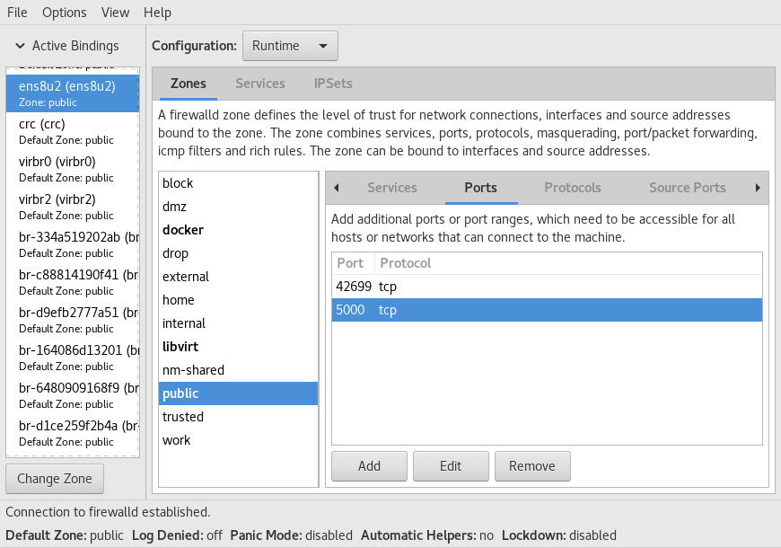

## Run Istio Gateway OTel tracing demo in Minikube

This demo part is based on minikube, QEMU/KVM, `kubectl`, helm 3, Docker CE,
Fedora 44, `firewall-config`, shell command `envstubst` (`gettext` package),
and the Docker registry image `registry:2`.

Fedora 44 is only used as an example OS here. Most parts work pretty much the
same on other Linux distributions as well.

The Bash script to run this demo is `mk.sh`.

Common usage:
```
cd minikube
./mk.sh --up     # start minikube KVM VM, build and run the full demo
./mk.sh --demo-down   # keep Instana agent running, stop the rest
# modify something
./mk.sh --up     # bring up the demo again
./mk.sh --down   # stop and remove the full demo including Instana agent from K8s
./mk.sh --stop   # delete minikube VM completely
```

### Implementation details

The Bash script `mk.sh` tries to emulate `docker-compose` behavior.
This is why `./mk.sh --up` builds the Docker images of the client-app,
the server-app and Istio Gateway with `docker-compose build` first.
Then it pushes those images to a local insecure Docker registry called
`myregistry` whose IP needs to be added to `/etc/hosts` on a Linux system.
The script starts `minikube` and deploys the client-app, the server-app,
the Instana agent, and Istio Gateway.
The `helm` command in version 3 is required to deploy the Instana agent.

### Install minikube on Fedora

Just follow a howto:

https://patterncatalyst.github.io/minikube-on-fedora/docs/02-installation/

**NOTE**: Install minikube 1.38.1 because 1.39.0 uses podman instead and is still unsupported.

### Install helm 3 on Fedora

Follow a howto:

https://helm.sh/docs/v3/intro/install

### Run the Docker registry

Ensure the current system has a static IP address (set static DHCP config in router).

Add a line with the external Ethernet IP address of your system to `/etc/hosts`:
```
# Example with IP 192.168.0.2:
sudo bash -c 'echo "192.168.0.2   myregisty" >> /etc/hosts'
```

The `mk.sh` script gathers automatically the IP address of the `myregistry`
this way and uses it to generate the resulting minikube YAML files, such as
`client-app-deployment.yaml`.

Open port TCP 5000 in local network firewall config.

Example on Fedora:
```
firewall-config
# find the zone of your Ethernet interface, open TCP port 5000 on that zone
# select "Options" -> "Runtime To Permanent" to save this permanently
```



Run the Docker registry:
```
sudo mkdir -p /srv/registry/data
docker run -d -p 5000:5000 --name registry -v /srv/registry/data:/var/lib/registry --restart always registry:2
```

The Docker registry is restarted upon system reboot.
